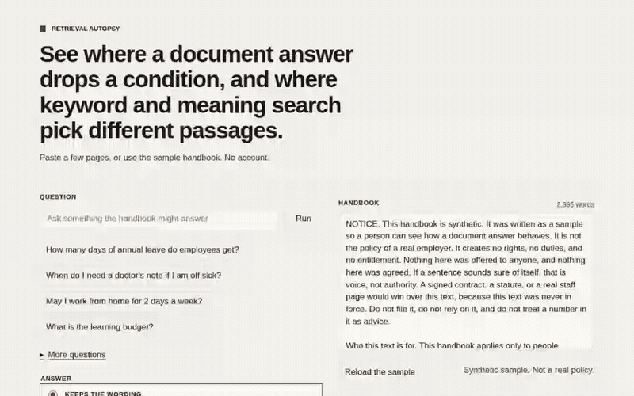

# Retrieval Autopsy

See where a document-answering bot drops a condition, and where keyword and meaning search pick different passages.



## Try it

No account. In the browser:

```bash
npm ci
npm run dev
```

Open the local page. The sample handbook is already loaded. It is synthetic. It is not a real policy.

1. Choose **How many days of annual leave do employees get?**
2. Choose **Drops conditions**.
3. Press **Run**.

Keyword search finds the passage. The answer says employees receive 30 days, and leaves out **full-time employees only**. Qualifier fails, and those words are marked in the passage.

You can paste your own text instead of the sample. **Keeps the wording** copies sentences out of the top passage. **Drops conditions** strips limits on purpose, so a failure is visible. The server model is not in the default build. A build with `VITE_SERVER_MODEL=1` adds it. It calls `/api/answer` and, if that is not available, uses the wording from the passage.

Meaning search downloads a small model the first time (`Xenova/all-MiniLM-L6-v2`). It runs in the browser. The handbook is not uploaded. Keyword results show up without waiting for it.

## How it judges

Read the sentence. Then read that sentence against the passage it came from.

- **Support.** Each sentence has to be made of words that are in a passage the search returned.
- **Scope.** If the handbook says who it is for, the answer cannot widen that to everyone.
- **Qualifier.** Words such as only and after, and the numbers, have to stay in the answer.
- **Omission.** An unless, an except, or a “not eligible” that would change the result has to stay too.

A failed check marks the exact words. The checks are rules and span matching. No model judges the answer.

The same four checks are in `scorer/`, for a JSONL file in CI. `fixtures/answers.jsonl` is the sample set. The pass rate has to stay at or above `scorer/baseline.json`.

```bash
pip install -e ./scorer
retrieval-autopsy fixtures/answers.jsonl --baseline scorer/baseline.json
```

Docker, from the repo root:

```bash
docker build -t retrieval-autopsy .
docker run --rm retrieval-autopsy fixtures/answers.jsonl --baseline scorer/baseline.json
```

`.github/workflows/scorecard.yml` fails a pull request when that rate drops. `.github/workflows/ci.yml` runs `npm run verify`.

## What AI built and what I decided

Built with Cursor cloud agents.

### What the agent wrote

Commit `92cb0f52e9f8b463a92f60adde4486595467fe41` (“Add Retrieval Autopsy”):

- The sample handbook and the eight questions (`src/sample/`).
- BM25 in TypeScript, chunking, and cosine ranking (`src/retrieve/`).
- The extractive answer and the mode that strips conditions (`src/answer/draft.ts`).
- The four checks (`src/score/score.ts`) and the same checks in Python (`scorer/`).
- The page: keyword beside meaning, the scorecard, and the short “How it judges” panel (`src/App.tsx`, `src/ui/`, `src/styles.css`, `DESIGN.md`).
- Lazy loading of the in-browser model (`src/retrieve/embed.ts`).
- `/api/answer` on a Worker, with a per-isolate rate limit and the extractive answer as the fallback (`worker/`).
- `wrangler.jsonc`, unit tests, the Playwright trap test, `fixtures/answers.jsonl`, the Dockerfile, and both GitHub workflows.
- The recording under `docs/retrieval-autopsy.gif` (about 4.6 seconds) and the screenshots next to it.

### What I decided

- TODO(Jakob): why these four checks.
- TODO(Jakob): why this handbook, and why these eight questions.
- TODO(Jakob): whether “Drops conditions” should be the mode a visitor sees first.
- TODO(Jakob): whether the meaning column should block the page until the model has loaded.
- TODO(Jakob): the accent, and the name in the sample handbook.

## Limitations

- The checks are lexical. A paraphrase that keeps the meaning and changes the words can fail Support, or can hide a dropped limit from Qualifier.
- Scope only notices a few widenings: “everyone”, “every worker”, and the other phrases in the checker, plus a claim that an excluded group is included. It will miss a quieter over-generalisation.
- “Drops conditions” is a handful of string rules. It is there so a failure is obvious. It is not a model of a careless writer.
- Keyword and meaning can disagree, and the scorecard can still pass, because it judges the answer against the passages that were retrieved, not against a passage you wish had been retrieved. Look at the two columns for that.
- Meaning search downloads the model and its runtime on first use. The first run is slow, and it needs a network. Later runs use the browser cache. Lighthouse on the first screen does not include that download.
- The in-memory rate limit on `/api/answer` is per isolate, eight requests a minute per address. It is not a global limit.
- The sample is fiction. Nothing in it is a policy.

## Develop

```bash
npm ci
npm run verify
```

`npm run verify` typechecks, lints, runs the unit tests, builds, runs the Playwright trap test, and runs pytest for `scorer/`.

## Deploy

The site is a static build in `./dist` plus a Worker for `/api/answer`. No secrets are required. The AI binding uses the account’s Workers AI binding, not a key in the repo.

```bash
npm ci
npm run build
npx wrangler@4 deploy
```

`wrangler.jsonc` is set up as:

- `name`: `retrieval-autopsy`
- `workers_dev`: `true`
- `preview_urls`: `false`
- `compatibility_date`: `2026-10-01`
- `assets.directory`: `./dist`, with single-page-application handling and an `ASSETS` binding
- `main`: `./worker/index.ts` (the `/api/answer` route)
- `ai.binding`: `AI`, used only by that route. The model is `@cf/meta/llama-3.1-8b-instruct`. On this Worker, if the binding is missing or the call fails, `/api/answer` returns 503 and the page uses the passage wording.

The copy at retrieval-autopsy.vercel.app is the static build only. It has no /api/answer route, so a request there returns 404 and the page uses the passage wording.

`npx wrangler deploy --dry-run` bundles the Worker and reads `./dist`. It does not publish.

Publishing with `workers_dev: true` creates a public `*.workers.dev` URL. The `/api/answer` route on that URL is public, with the per-isolate limit above. Removing the `ai` block disables the server model and leaves the rest of the page working. That deploy choice is the owner’s.
